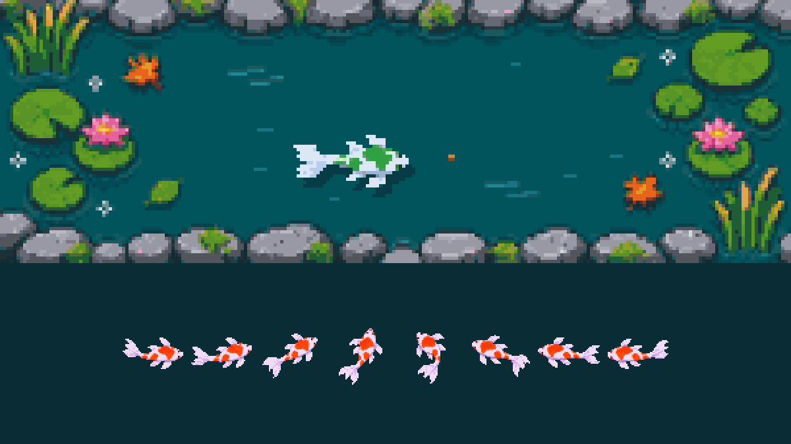
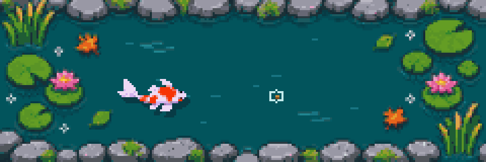

<picture>
  <source media="(prefers-color-scheme: dark)" srcset="assets/hero-dark.svg">
  
</picture>

  &nbsp;&nbsp;
  &nbsp;&nbsp;
  &nbsp;&nbsp;
  &nbsp;&nbsp;
  

I build immersive apps for headsets and the browser in Unity and WebXR. I also make the tools around them: computer vision that reads people and poses, and AI tooling that lets agents work inside 3D software. Earlier I built IoT sensors, browser games and gesture interfaces, and I still enjoy anything that turns a camera or a sensor into input.

## Selected work

<table>
  <tr>
    <td width="50%" valign="top">
      
      <h3><a href="https://github.com/MemeGamer/blendpro-mcp">BlendPro MCP</a></h3>
      Text-first Blender control for AI agents: scene diffs instead of screenshots, node trees as JSON, 100 tested recipes and MediaPipe pose understanding for characters.
        <code>Python</code> <code>Blender</code> <code>MCP</code> <code>MediaPipe</code>
    </td>
    <td width="50%" valign="top">
      
      <h3><a href="https://github.com/MemeGamer/git-koi-pixel">git-koi-pixel</a></h3>
      A pixel-art koi pond for GitHub profiles. The koi swims, eats, turns and grows with your public activity, and wears the colours of your languages. It ships as a GitHub Action with its own sprite sheets, and the koi further down this page is drawn with it.
        <code>Python</code> <code>GitHub Actions</code> <code>Pixel art</code> <code>Pillow</code>
    </td>
  </tr>
</table>

## Stack

<picture>
  <source media="(prefers-color-scheme: dark)" srcset="assets/stack-dark.svg">
  
</picture>

## Earlier projects

| Area | Projects |
|---|---|
| Computer vision | [Webcam dataset creator](https://github.com/MemeGamer/webcam-dataset-creator), [hand sign dataset builder](https://github.com/MemeGamer/hand-sign-dataset-builder), [AirCanvas](https://github.com/MemeGamer/air-canvas), [real-time sign language detection](https://github.com/MemeGamer/realtime-sign-language-detection), [YOLO object detection](https://github.com/MemeGamer/yolo-realtime-object-detection), [hand gesture recognition in JS](https://github.com/MemeGamer/hand-gesture-recognition-js) |
| IoT and embedded | [Weather station](https://github.com/MemeGamer/nodemcu-weather-station), [NodeMCU sensor monitor with ThingSpeak and SMS](https://github.com/MemeGamer/nodemcu-air-pollution-monitor), [gesture magic wand on Nano 33 BLE Sense](https://github.com/MemeGamer/magic-wand-nano33-ble) |
| Unity | [2D bird adventure](https://github.com/MemeGamer/unity-2d-bird-adventure), [2D player controller](https://github.com/MemeGamer/unity-2d-player-controller), [JSON GET and POST](https://github.com/MemeGamer/unity-json-get-post), [FPS with JSON sync](https://github.com/MemeGamer/unity-fps-json-sync) |

## On GitHub

<picture>
  <source media="(prefers-color-scheme: dark)" srcset="assets/stats-dark.svg">
  
</picture>

