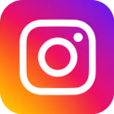
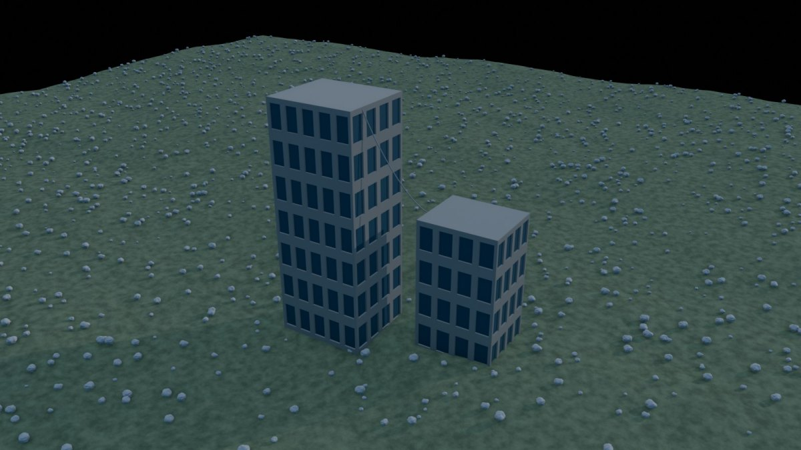
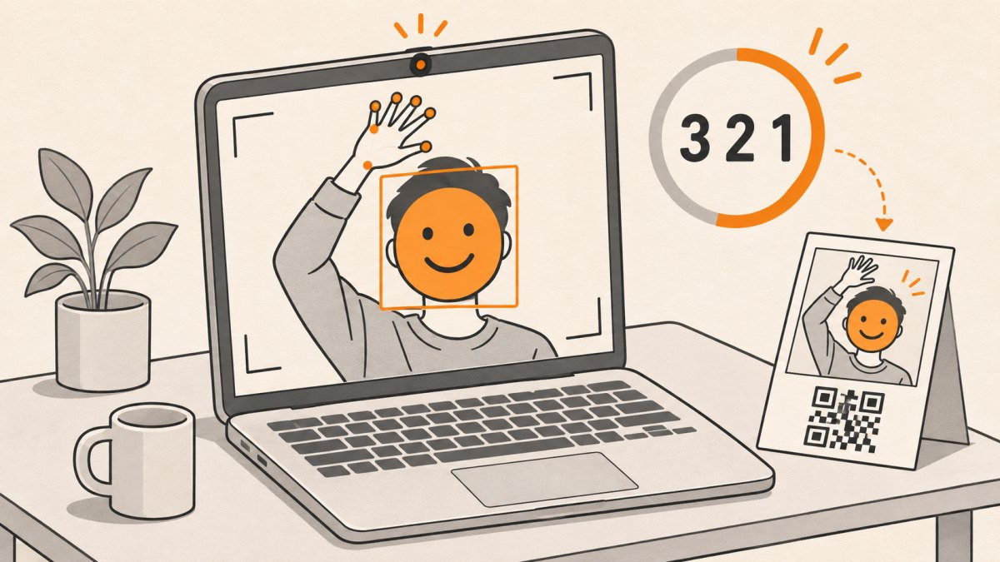
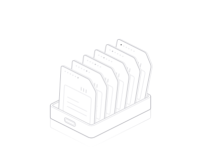
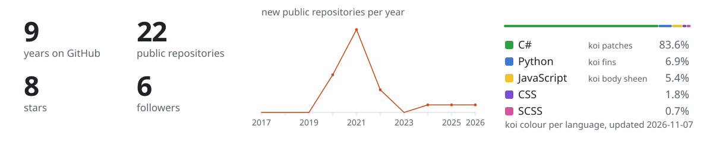

<picture>
  <source media="(prefers-color-scheme: dark)" srcset="assets/hero-dark.svg">
  
</picture>

  &nbsp;&nbsp;
  &nbsp;&nbsp;
  &nbsp;&nbsp;
  &nbsp;&nbsp;
  

I build immersive apps for headsets and the browser in Unity and WebXR. I also make the tools around them: computer vision that reads people and poses, and AI tooling that lets agents work inside 3D software. Earlier I built IoT sensors, browser games and gesture interfaces, and I still enjoy anything that turns a camera or a sensor into input.

## Selected work

<table>
  <tr>
    <td width="50%" valign="top">
      
      <h3><a href="https://github.com/MemeGamer/blendpro-mcp">BlendPro MCP</a></h3>
      Text-first Blender control for AI agents: scene diffs instead of screenshots, node trees as JSON, 100 tested recipes and MediaPipe pose understanding for characters.
        <code>Python</code> <code>Blender</code> <code>MCP</code> <code>MediaPipe</code>
    </td>
    <td width="50%" valign="top">
      
      <h3><a href="https://github.com/MemeGamer/AR_Emoji_Photo_Bhooth">AR Emoji Photo Booth</a></h3>
      A browser photo booth: raise a hand to start the countdown, swipe to change the emoji tracked on your face, then download the photo from a QR code. <a href="https://aremojibooth.netlify.app/">Try it live</a>.
        <code>JavaScript</code> <code>MediaPipe</code> <code>WebRTC</code>
    </td>
  </tr>
</table>

## Stack

<table>
  <tr>
    <td width="36%" valign="middle">
      <a href="https://memegamer.github.io/MemeGamer/rack.html">
        <picture>
          <source media="(prefers-color-scheme: dark)" srcset="assets/rack-dark.svg">
          
        </picture>
      </a>
    </td>
    <td width="64%" valign="middle">
      Six cartridges, one per area: XR and 3D, languages, vision, web and cloud, design, hardware.
        
      <a href="https://memegamer.github.io/MemeGamer/rack.html">Open the live figure</a> and hover a cartridge to pull it from the dock.
    </td>
  </tr>
</table>

<picture>
  <source media="(prefers-color-scheme: dark)" srcset="assets/stack-dark.svg">
  
</picture>

## Earlier projects

| Area | Projects |
|---|---|
| Computer vision | [AirCanvas](https://github.com/MemeGamer/AirCanvas), [real-time sign language detection](https://github.com/MemeGamer/Realtime_SignLangageDetection), [YOLO object detection](https://github.com/MemeGamer/RealTime_ObjectDetection_Yolo), [hand gesture recognition in JS](https://github.com/MemeGamer/Hand_gestureRecognition_JS) |
| IoT and embedded | [Weather station](https://github.com/MemeGamer/Weather_Station_IOT), [pollution detection on NodeMCU](https://github.com/MemeGamer/PollutionDetectio_IOT_NodeMCU), [gesture magic wand on Nano 33 BLE Sense](https://github.com/MemeGamer/MagicWand_nano_ble33_sense) |
| Unity and WebGL games | [Ludo Online](https://github.com/MemeGamer/LudoOnlineNetlify), [Poker Online](https://github.com/MemeGamer/PokerOnline), [Unity GET and POST requests](https://github.com/MemeGamer/GetNPostRequestUnity) |

## On GitHub

<picture>
  <source media="(prefers-color-scheme: dark)" srcset="assets/stats-dark.svg">
  
</picture>

Every image here lives in this repository. The stats card is regenerated daily by a GitHub Action (<code>scripts/stats.mjs</code>), so nothing depends on an outside service.
